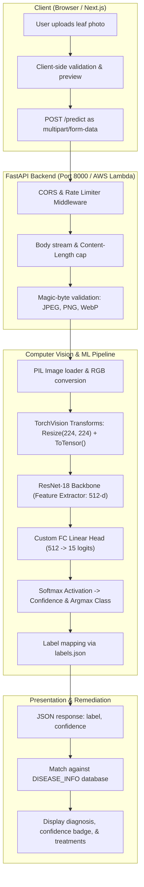
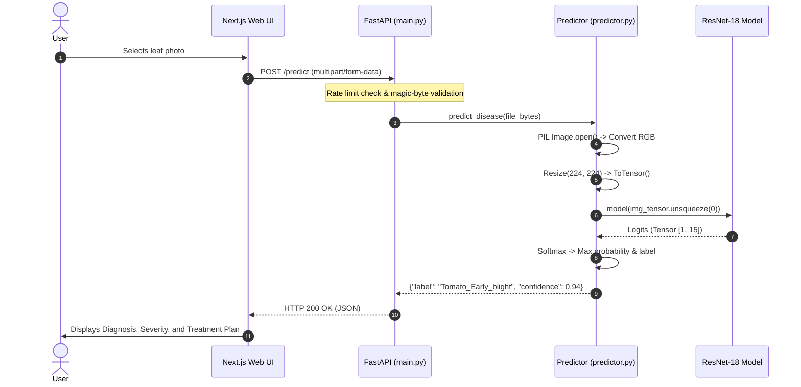

# LeafGuardian · Architecture & Machine Learning Specification

LeafGuardian is an end-to-end full-stack computer vision application designed to diagnose plant diseases from leaf photographs. It classifies 15 distinct health conditions across Bell Pepper, Potato, and Tomato crops in real time.

---

## 1. System Architecture Overview

The system follows a decoupled, three-tier architecture:

1. **Client Tier (Web Frontend)**: Next.js 15 (React 19, TypeScript, Tailwind CSS v4) with client-side image preview, scan history persistence in `localStorage`, and dynamic treatment recommendations.
2. **API & Server Tier (Backend)**: FastAPI (Python 3.11) with Uvicorn, custom streaming multipart request parsing, rate limiting, and CORS handling.
3. **Inference & Computer Vision Tier**: PyTorch and TorchVision running a fine-tuned ResNet-18 Convolutional Neural Network (CNN) with weights loaded onto CPU or CUDA.



---

## 2. Machine Learning Model Architecture

### Backbone: ResNet-18 (Residual Network)

The underlying computer vision model is **ResNet-18**, an 18-layer Convolutional Neural Network introduced by He et al. (Microsoft Research).

#### Why ResNet-18?
- **Residual / Skip Connections**: Traditional deep networks suffer from the *degradation problem* (vanishing gradients as depth increases). ResNet solves this by introducing shortcut connections that perform identity mappings:
  $$\mathbf{y} = \mathcal{F}(\mathbf{x}, \{W_i\}) + \mathbf{x}$$
  This ensures gradients propagate directly through the skip connections during backpropagation.
- **Inference Speed & Weight Footprint**: With ~11.2 million parameters, the serialized weights (`model_state.pt`) are only **44.8 MB**, enabling sub-200ms CPU inference on AWS Lambda or low-spec cloud instances without requiring costly GPU instances.

#### Layer Breakdown

| Stage | Layer Details | Output Dimensions |
|---|---|---|
| **Input** | RGB Image | $3 \times 224 \times 224$ |
| **Stem** | Conv $7\times 7$, stride 2, padding 3 + BatchNorm + ReLU | $64 \times 112 \times 112$ |
| **Max Pool** | $3\times 3$, stride 2, padding 1 | $64 \times 56 \times 56$ |
| **Layer 1** | 2 Residual Blocks (each: 2 $\times$ Conv $3\times 3$, 64 filters) | $64 \times 56 \times 56$ |
| **Layer 2** | 2 Residual Blocks (each: 2 $\times$ Conv $3\times 3$, 128 filters, stride 2) | $128 \times 28 \times 28$ |
| **Layer 3** | 2 Residual Blocks (each: 2 $\times$ Conv $3\times 3$, 256 filters, stride 2) | $256 \times 14 \times 14$ |
| **Layer 4** | 2 Residual Blocks (each: 2 $\times$ Conv $3\times 3$, 512 filters, stride 2) | $512 \times 7 \times 7$ |
| **Pooling** | Adaptive Average Pooling ($1\times 1$) | $512 \times 1 \times 1$ |
| **Head (FC)** | `nn.Linear(in_features=512, out_features=15)` | $15$ logits |

---

## 3. Transfer Learning & Training Pipeline

### Transfer Learning Strategy

LeafGuardian trains on top of weights pre-trained on the **ImageNet-1K** dataset (`ResNet18_Weights.IMAGENET1K_V1`):
1. **Feature Extraction Reuse**: Early convolutional filters already detect low-level visual primitives (edges, gradients, color transitions, circular spots, and textures).
2. **Head Customization**: The original 1,000-class ImageNet classification layer is replaced with a custom linear layer outputting 15 disease classes:
   ```python
   model = models.resnet18(weights=models.ResNet18_Weights.IMAGENET1K_V1)
   model.fc = nn.Linear(model.fc.in_features, 15)  # 512 -> 15
   ```

### Training Configuration ([train.py](file:///home/skullsmasher/MP/GreenGuardian/backend/train.py))

- **Dataset**: [PlantVillage](https://www.kaggle.com/datasets/emmarex/plantdisease) dataset covering diseased and healthy leaves.
- **Split Ratio**: 80% Train, 10% Validation, 10% Test (generated via [splitdataset.py](file:///home/skullsmasher/MP/GreenGuardian/backend/splitdataset.py) with seed 42).
- **Optimizer**: `optim.Adam(model.parameters(), lr=0.001)`
- **Loss Function**: `nn.CrossEntropyLoss()`
- **Batch Size**: 32
- **Epochs**: 10
- **Model Checkpoint**: Saved strictly as a weights dictionary (`state_dict`) to prevent arbitrary code execution on deserialization:
  ```python
  torch.save(model.state_dict(), "model/model_state.pt")
  ```

### Disease Classes (15 Classes)

Mapped in [backend/model/labels.json](file:///home/skullsmasher/MP/GreenGuardian/backend/model/labels.json):

```
0:  Pepper__bell___Bacterial_spot
1:  Pepper__bell___healthy
2:  Potato___Early_blight
3:  Potato___Late_blight
4:  Potato___healthy
5:  Tomato_Bacterial_spot
6:  Tomato_Early_blight
7:  Tomato_Late_blight
8:  Tomato_Leaf_Mold
9:  Tomato_Septoria_leaf_spot
10: Tomato_Spider_mites_Two_spotted_spider_mite
11: Tomato__Target_Spot
12: Tomato__Tomato_YellowLeaf__Curl_Virus
13: Tomato__Tomato_mosaic_virus
14: Tomato_healthy
```

---

## 4. Computer Vision & Inference Pipeline

When a user submits an image, the prediction pipeline executes the following steps:



### 1. Magic-Byte Image Validation
Before invoking the ML framework, [main.py](file:///home/skullsmasher/MP/GreenGuardian/backend/main.py#L201-L215) validates the binary stream header:
- **JPEG**: Starts with `FF D8 FF`
- **PNG**: Starts with `89 50 4E 47` (`\x89PNG`)
- **WebP**: Starts with `RIFF` and contains `WEBP`

### 2. Preprocessing & Tensor Normalization
Implemented in [model/predictor.py](file:///home/skullsmasher/MP/GreenGuardian/backend/model/predictor.py#L42-L59):
1. **Color Normalization**: PIL loads the image and converts any palette/RGBA/grayscale input to 3-channel RGB:
   ```python
   image = Image.open(io.BytesIO(image_bytes)).convert("RGB")
   ```
2. **Spatial Resizing**: Resizes the image to fixed spatial dimensions of $224 \times 224$ pixels using bilinear interpolation.
3. **Tensor Conversion**: `transforms.ToTensor()` converts the PIL image (values in range $[0, 255]$) into a PyTorch float tensor of shape $(3, 224, 224)$ with values scaled to $[0.0, 1.0]$.
4. **Batch Dimension**: `.unsqueeze(0)` shapes the tensor to $(1, 3, 224, 224)$.

### 3. Forward Pass & Probability Extraction
```python
with torch.no_grad():
    outputs = self.model(img_tensor)       # Raw logits: shape [1, 15]
    probs = torch.softmax(outputs, dim=1)   # Normalized probabilities: sum(probs) = 1.0
    conf, pred_idx = probs.max(dim=1)       # Maximum confidence and class index
```
- Softmax converts unconstrained logits $z_i$ into probabilities:
  $$\sigma(z)_i = \frac{e^{z_i}}{\sum_{j=1}^{15} e^{z_j}}$$
- Returns the class index and its confidence (e.g., $0.94$).

---

## 5. Web Frontend & Treatment Knowledge Base

The client interface ([PredictionResult.tsx](file:///home/skullsmasher/MP/GreenGuardian/web/src/components/PredictionResult.tsx)) connects the raw model output to actionable agronomic advice:

1. **Label Formatting**: Translates raw machine keys (`Tomato_Early_blight`) into formatted titles (`Tomato · Early Blight`).
2. **Confidence Stratification**:
   - **High Confidence ($\ge 80\%$)**: Green indicator badge.
   - **Moderate Confidence ($60\% - 79\%$)**: Amber indicator badge.
   - **Low Confidence ($< 60\%$)**: Warning badge advising a clearer or closer photograph.
3. **Botanical Knowledge Base**:
   An embedded agronomic database matches conditions to specific pathogens and treatments:
   - **Early Blight (*Alternaria solani*)**: Concentric ring lesions; copper fungicide recommendations every 7–10 days; soil-level watering.
   - **Late Blight (*Phytophthora infestans*)**: Dark water-soaked lesions; rapid isolation; systemic fungicides (chlorothalonil/mancozeb).
   - **Bacterial Spot (*Xanthomonas spp.*)**: Water-soaked spots with yellow halos; tool sanitization; preventive copper bactericides.
   - **Leaf Mold (*Passalora fulva*)**: Olive-green spores; humidity management below 85%; greenhouse ventilation.
   - **Spider Mites (*Tetranychus urticae*)**: Stippling and webbing; insecticidal soap, neem oil, and predatory mite introduction.
   - **Healthy Plants**: Preventative maintenance and standard watering schedule.

---

## 6. Deployment Topologies

The application supports two operating modes:

### Local Development
- **Backend**: FastAPI running under Uvicorn (`http://localhost:8000`), with an in-memory sliding-window IP rate limiter.
- **Frontend**: Next.js development server running on `http://localhost:3000` (or `3001` if 3000 is occupied).
- **CORS**: Configured via regex to accept requests from any `localhost` or `127.0.0.1` port.

### Serverless Cloud Architecture (AWS)
- **AWS Lambda Container**: Backend packaged using [Dockerfile.lambda](file:///home/skullsmasher/MP/GreenGuardian/backend/Dockerfile.lambda) from `public.ecr.aws/lambda/python:3.9` (or 3.11).
- **Mangum Adapter**: [lambdahandler.py](file:///home/skullsmasher/MP/GreenGuardian/backend/lambdahandler.py) uses Mangum to bridge API Gateway HTTP events to the ASGI FastAPI application.
- **Static Hosting**: Frontend built via `next build` and exported to Amazon S3 fronted by AWS CloudFront.
